<div align="center">


<br>

[](LICENSE)
[](#quick-start)
[](#use-via-cdn)
[](icons.json)
[](CONTRIBUTING.md)
[](../../issues/new?template=icon-request.md)

**[Browse the gallery](#)** · **[Quick start](#quick-start)** · **[FAQ](#faq)** · **[Contribute](#contributing)**

</div>



## What is tech-stack-icons?

**tech-stack-icons is a free, open-source library of 3,692+ SVG icons for programming languages, frameworks, developer tools, cloud platforms, databases, AI products, SEO and analytics tools, messaging apps and popular brands.** It aims to be the most complete SVG icon set for tech stacks, portfolios, documentation and web apps.

It combines the full [devicon](https://github.com/devicons/devicon) catalog (with its original, plain, line and wordmark variants) and the [Simple Icons](https://simpleicons.org) catalog, deduplicated and organized in one consistent structure, so every icon is available through one URL pattern and one machine-readable `icons.json`. See [NOTICE.md](NOTICE.md) for sources and licenses. Scope rules are in [CONTRIBUTING.md](CONTRIBUTING.md#scope-what-belongs-here). Built and maintained by [pawang-ai](https://github.com/pawang-ai).

## Why use it

- **Wide coverage.** 3,692+ icons and 8,160 SVG files across 19 categories, from languages and cloud to SEO, messaging, email and finance.
- **Clean SVG.** Optimized, scalable, no tracking, no runtime dependency.
- **Multiple variants.** Colored and monochrome, with or without wordmark.
- **CDN-ready.** Load any icon by URL, no install needed.
- **Machine-readable.** One `icons.json` with names, aliases, tags and brand colors.
- **Open and permissive.** MIT-licensed code, with a clear trademark policy for logos.


## Quick start

### Use via CDN

```html

```

URL pattern:

```text
https://cdn.jsdelivr.net/gh/pawang-ai/tech-stack-icons@main/icons/{name}/{name}-{variant}.svg
```

### Use in a GitHub README

```md
<p align="left">
  
  
  
  
  
</p>
```

### Install from npm

```bash
npm install tech-stack-icons
```

```js
import icons from "tech-stack-icons/icons.json";

const react = icons.find((i) => i.name === "react");
console.log(react.versions.svg); // ["original", "original-wordmark", "plain", ...]
```

### Copy the SVG

Open any file in [`/icons`](icons) and paste the raw SVG into your project.


## Icon variants

| Variant | Description | Typical use |
| --- | --- | --- |
| `original` | Full-color brand logo | Portfolios, READMEs |
| `original-wordmark` | Full-color logo with the name | Tech stack sections |
| `original-wordmark-dark` | Wordmark with light text, for dark backgrounds | Dark-mode pages |
| `plain` | Single-shape. Simple Icons versions use `currentColor` (black via ``, recolor by inlining the SVG) | Themes, dark mode |
| `plain-wordmark` | Single-shape with the name | Footers, badges |
| `line` | Outline style | Minimal UIs |

## Categories

| Category | Icons | Examples |
| --- | ---: | --- |
| Programming languages | 93 | JavaScript, TypeScript, Python, Go, Rust |
| Frameworks and libraries | 204 | React, Next.js, Vue.js, Svelte, Hono |
| Databases and ORM | 51 | PostgreSQL, MongoDB, MySQL, Prisma, Drizzle |
| Cloud and hosting | 45 | AWS, Google Cloud, Vercel, Netlify, Hetzner |
| CI/CD, DevOps and testing | 122 | Kubernetes, GitHub Actions, Terraform, Jest, npm |
| AI and machine learning | 34 | PyTorch, TensorFlow, Hugging Face, DeepSeek, Mistral AI |
| Editors and terminals | 59 | VS Code, Neovim, Vim, IntelliJ IDEA, Ghostty |
| Operating systems | 35 | Linux, Ubuntu, Debian, FreeBSD, AlmaLinux |
| Design | 23 | Figma, Blender, Krita, Canva, Babylon.js |
| Data and analytics | 25 | Google Sheets, Excel, Power BI, Tableau, Microsoft Clarity |
| SEO and webmaster tools | 8 | Google Search Console, Bing, Ahrefs, Semrush, Screaming Frog |
| Messaging | 12 | WhatsApp, Telegram, Discord, Zoom, Element |
| Email | 13 | Gmail, Outlook, Proton Mail, SendGrid, Resend |
| Productivity and office | 15 | PowerPoint, Obsidian, Asana, Airtable, ClickUp |
| Social media | 34 | YouTube, Instagram, TikTok, Reddit, Pinterest |
| Finance, payments and crypto | 37 | PayPal, Stripe, Bitcoin, Ethereum, Visa |
| Entertainment and gaming | 29 | Steam, Netflix, PlayStation, Apple Music, Apple Podcasts |
| Education | 16 | Udemy, Coursera, Codecademy, freeCodeCamp, CodeChef |
| Everything else | 2,837 | 1Password, Brave, Firefox, Chrome, Airbnb |

> The catalog grows with every release. See [`icons.json`](icons.json) for the full, current list.

## Repository structure

```text
tech-stack-icons/
├─ icons/
│  └─ {name}/
│     ├─ {name}-original.svg
│     ├─ {name}-plain.svg
│     └─ {name}-original-wordmark.svg
├─ assets/              # README visuals
├─ icons.json           # catalog: name, altnames, tags, versions, color
├─ CONTRIBUTING.md
├─ CITATION.cff
├─ llms.txt             # summary for AI assistants
└─ LICENSE
```

### `icons.json` entry

```json
{
  "name": "react",
  "altnames": [
    "reactjs"
  ],
  "category": "frameworks",
  "tags": [
    "framework",
    "frameworks"
  ],
  "versions": {
    "svg": [
      "original",
      "original-wordmark"
    ]
  },
  "color": "#61dafb",
  "source": "devicon"
}
```


## FAQ

### What is tech-stack-icons?
A free, open-source SVG icon library of programming languages, frameworks, tools, cloud platforms and AI brands, available through a CDN, npm or direct download.

### How do I add tech icons to my GitHub README?
Use an `` tag that points to the jsDelivr URL of the icon, as shown in [Quick start](#use-in-a-github-readme). Set `width` to control the size.

### How is it different from devicon?
It includes every devicon icon with its variants, then adds 3,021 more from Simple Icons (AI tools, SEO and analytics tools, messaging, email, finance, gaming and more), all under one naming scheme with categories and a single catalog file.

### Can I change an icon's color?
Yes. Inline the SVG and set `fill` on its paths, or use the `plain` variants, which are built for recoloring.

### Can I use the icons commercially?
Repository code and original artwork are MIT-licensed; devicon artwork is MIT and Simple Icons artwork is CC0. Brand logos remain the property of their owners and must be used according to each brand's guidelines. See [Trademarks](#trademarks-and-takedown).

### How do I request a missing icon?
[Open an icon request](../../issues/new?template=icon-request.md) with the official name, website and preferred variants.

## Contributing

Contributions are welcome: new icons, fixes, docs and tooling.

1. Fork the repository and create a branch.
2. Add the SVG under `icons/{name}/` following the naming pattern.
3. Add or update the entry in `icons.json`.
4. Open a pull request. CI validates naming, size and SVG structure.

Read [CONTRIBUTING.md](CONTRIBUTING.md) for the full guide.

## Trademarks and takedown

All product names, logos and brands are the property of their respective owners. Their use here is for identification only and does not imply endorsement. Follow each brand's usage policy.

If you are a rights holder and want a logo changed or removed, [open an issue](../../issues) or contact the maintainers and it will be handled promptly.

## Credits

Icon artwork comes from [devicon](https://github.com/devicons/devicon) (MIT) and [Simple Icons](https://simpleicons.org) (CC0 1.0), plus logos and original artwork contributed by the maintainers. See [NOTICE.md](NOTICE.md). Thanks to every contributor.

## Citation

If you use this library in research or documentation, cite it using [`CITATION.cff`](CITATION.cff).

## License

Code and original artwork are released under the [MIT License](LICENSE). Third-party artwork keeps its own license, listed in [NOTICE.md](NOTICE.md).


<div align="center">

Built with care by **[pawang-ai](https://github.com/pawang-ai)**

</div>
